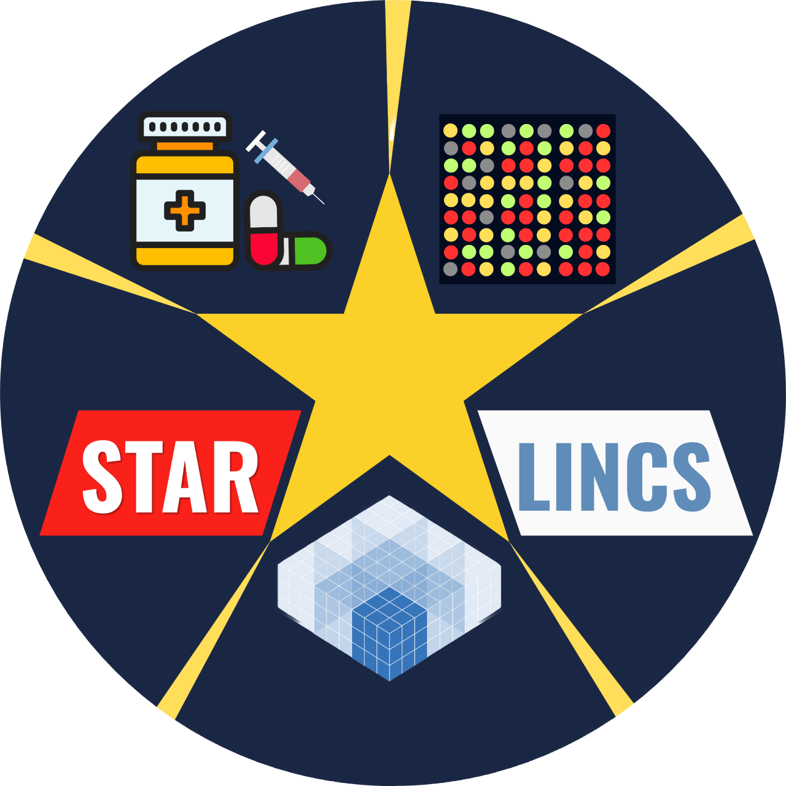

<p align="left">
  
</p>

# **STARLINCS**

> **Signature-driven Transcriptome Alignment for Repurposing**

[](LICENSE)


[](https://github.com/epigen-bioinfolab/CHROMACS/releases)

  </div>
</div>

## About


STARLINCS ranks drugs by the similarity (or reversal) between a user-supplied gene expression signature and reference chemical-perturbation signatures, using a Gene Set Enrichment Analysis-based approach. It is available both as a **Graphical User Interface** and a **Command Line Interface**.


## Features

- **Tissue-specific reference presets**: bone, breast, cervix, central nervous system, haematopoietic and lymphoid tissue, kidney, large intestine, liver, lung, pancreas, placenta, prostate, skin, soft tissue — or supply your own reference CSV
- **Two modes**
  - `reverse` — rank drugs that reverses the transcriptomic signature (e.g. for drug repurposing against a disease signature)
  - `mimic` — rank drugs that reproduce your signature (e.g. for identifying mode of action of novel compounds)
- **Graphical User Interface** built with Tkinter for interactive use
- **Command-Line Interface** for batch/scripted analysis
- Optional export of leading-edge genes for top-ranked drugs

## Pre-requisite
- `Python 3.8+`: for gseapy dependency (Tested on Python 3.14 or older versions)
- `pandas`, `gseapy`, `numpy` (installed automatically by `install.sh`)
- `tkinter` (for the GUI; installed automatically by `install.sh`)
- For macOS users, `Rust` (Pre-built wheel doesn't exist for gseapy; Installed automatically by `install.sh`)


## Installation
### For Linux, Windows and macOS users
#### Step 1: Download the file
```bash
wget https://github.com//starlincs/archive/refs/heads/main.zip
unzip main.zip
```
#### Alternative
```bash
git clone https://github.com/epigen-bioinfolab/STARLINCS.git
cd STARLINCS
```

#### Alternative
[](https://github.com/USERNAME/REPO/releases/latest/download/file.zip)

#### Step 2: Run the following command for installation
```bash
cd starlincs
chmod +x install.sh && ./install.sh
```

## Usage

### Graphical User Interface

```bash
starlincs gui
```

Launches the graphical user interface, where user can select organ/tissue reference, upload up/down-regulated gene lists, choose mimic/reverse mode, configure GSEA parameters, and view/export results.

### Command-Line Interface

```bash
starlincs run \
    --reference lung \
    --up up_genes.txt \
    --down down_genes.txt \
    --mode reverse \
    --min-gene 20 \
    --max-gene 500 \
    --seed 1234 \
    --nperm 1000 \
    --output results
```

#### Arguments

|Argument |Required |Description |
|---|---|---|
| `--reference` | **Yes** | Tissue preset name (e.g. `lung`) or path to a custom drug-gene CSV |
| `--up` | **Yes** | Plain-text file of upregulated gene symbols, one per line |
| `--down` | **Yes** | Plain-text file of downregulated gene symbols, one per line |
| `--mode` | **Yes** | `mimic` or `reverse` |
| `--seed` | No | Random seed (default: `1234`) |
| `--nperm` | No | Number of permutations (default: `1000`) |
| `--max-gene` | No | Maximum genes per set (default: `500`) |
| `--min-gene` | No | Minimum genes per set (default: `20`) |
| `--output` | **Yes** | Output directory for `STARLINCS_results.csv` |
| `--include-leading-genes` | No | Export leading genes for the top N drugs as a zip |


## Output
Running an analysis produces:

- `STARLINCS_results.csv` — ranked drugs with connectivity scores, target, mode of action, canonical SMILES, InChI key in the chosen output directory
- `<drug_name>_leading_genes.zip` (optional) — leading-edge up/down gene lists for top-ranked drugs
- `starlincs.log` — detailed session log written to the current working directory

## Contact

For any queries and support, please reach us at **epigen.bioinfolab@gmail.com**  
Visit our lab page: [www.epigen-bioinfolab.com](https://www.epigen-bioinfolab.com/)

## License
This project is licensed under the MIT License - see the [LICENSE](LICENSE) file for details.


